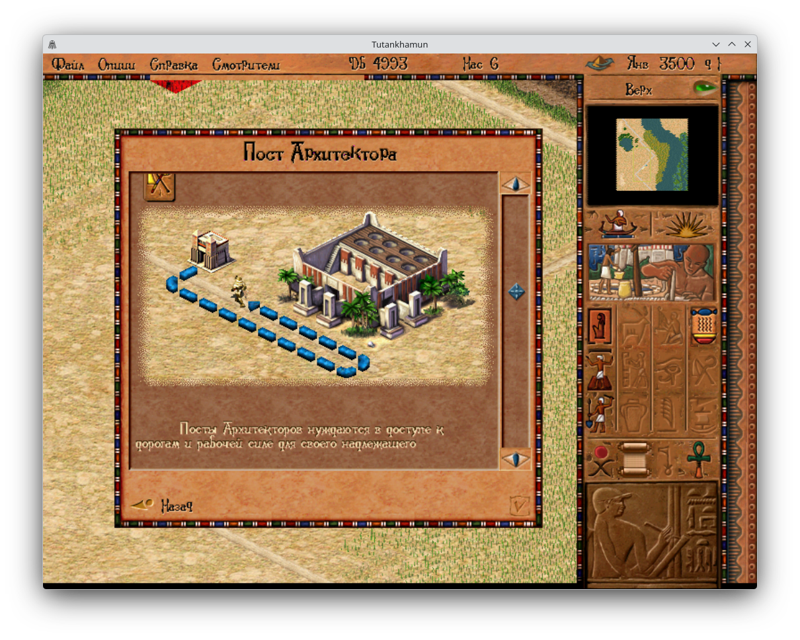

# Tutankhamun – Russian Triada Localisation Fork

A Russian localisation compatibility fork of [Tutankhamun](https://github.com/dalerank/tutankhamun), an open-source re-implementation of **Pharaoh + Cleopatra** (Impressions Games, 2000) in C.

This fork adds support for the **Russian Triada localisation**, including a Triada-specific character-to-glyph mapping that allows the original Russian text and font assets to be rendered correctly.

The project retains the original game's logic, graphics, gameplay behaviour and save-file compatibility. It runs on modern Windows, Linux and macOS, as well as Android, using the original game data.

## Russian Triada localisation

The main purpose of this fork is to provide compatibility with the Russian localisation released by **Triada**.

The original game uses a custom character-to-glyph mapping to display text through its bitmap fonts. Different localised editions may use different mappings, which can result in incorrect characters being displayed when their game data is used with an incompatible engine.

This fork incorporates a Triada-specific character mapping:

- Correct rendering of Russian Cyrillic text.
- Compatibility with the original Triada font assets.
- Preservation of the original Russian text resources.
- No need to modify the original game executable or replace the localisation files.

## Requirements

Tutankhamun requires the original **Pharaoh + Cleopatra** game files.

You must provide your own copy of the game with the Russian Triada localisation installed. No original game assets, executable files, fonts or translation resources are distributed in this repository.

The game uses the original installation's data files and retains compatibility with the original save-file format.

## Running the game

| Platform | Build instructions |
| -------- | ------------------ |
| Windows (32-bit) | [docs/windows.md](docs/windows.md) |
| Windows x64 | [docs/windows.md](docs/windows.md) |
| Linux | [docs/linux.md](docs/linux.md) |
| macOS arm64 | [docs/macos.md](docs/macos.md) |
| macOS x64 | [docs/macos.md](docs/macos.md) |
| Android | [docs/android.md](docs/android.md) |

You need an installed copy of Pharaoh + Cleopatra 2.1 with the Triada localisation. The game uses its original data files and can locate the installation automatically or accept its location through the [command line](docs/command-line.md).

Like the original, it stores player profiles and saved games in the original format.

**Free play:** The main menu's second button allows you to select a family and access the Pharaoh and Cleopatra missions without changing campaign progress, records or high scores.

**Resolutions:** Any resolution from 640 × 480 up to the display's native resolution is supported. F7 / F8 / F9 and F6 (full screen) work as in the original.

**Discord:** On desktop platforms, the game can display the current mission in your Discord status (`config/discord.json` can disable this feature).

## Building from source

All platforms use the same CMake project, with SDL2 and SDL2_mixer fetched and linked statically.

- [Windows build instructions](docs/windows.md#building)
- [Linux build instructions](docs/linux.md#building)
- [macOS build instructions](docs/macos.md#building)
- [Android build instructions](docs/android.md#building)
- [General build documentation](BUILD.md)

The Triada character mapping is included in the source code, so no additional encoding files need to be installed at runtime.

## Relationship with the original project

This repository is a downstream fork of [dalerank/tutankhamun](https://github.com/dalerank/tutankhamun).

The original project provides the game engine re-implementation, while this fork focuses on Russian Triada localisation compatibility.

All original project credits and third-party component attributions are retained. This fork is independently maintained and is not an official release of the upstream project.

Upstream releases and nightly builds do not include the changes made in this fork.

## Credits

Original project: [Tutankhamun](https://github.com/dalerank/tutankhamun) by dalerank.

Parts of the code come from other projects (details: [LICENSES/README.md](LICENSES/README.md) and individual file headers):

- [Akhenaten](https://github.com/dalerank/Akhenaten): the Bink video decoder (`src/third_party/akhenaten_bink`), SDL build scripts (`cmake/`), Discord presence, mouse cursors and several UI components.
- [Julius](https://github.com/bvschaik/julius): `src/platform/sound_device.c`, `src/platform/screen.c`, cursor pixel art and the select list used by the resolution selector.
- The GitHub picture of the link buttons is the Simple Icons mark (CC0-1.0).

Third-party libraries: SDL2 2.32.10 (zlib), SDL2_mixer 2.8.0 (zlib) with minimp3 (CC0-1.0), and parson 1.5.3 (MIT). Their licence texts are available in `LICENSES/`.

## License

The project's own code is distributed under the MIT License ([LICENSE](LICENSE)).

Files taken from Julius and Akhenaten retain their AGPL-3.0 licence ([LICENSES/AGPL-3.0.txt](LICENSES/AGPL-3.0.txt)). A program built with these files is distributed under AGPL-3.0 as a whole.

All original third-party licence terms and attributions are retained.

Tutankhamun is not affiliated with or endorsed by the owners of Pharaoh and Cleopatra. The game's data, names and trademarks belong to their respective owners. You must provide your own copy of the original game.
